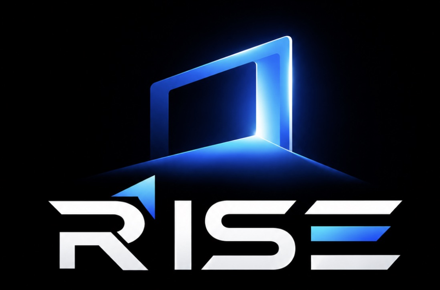
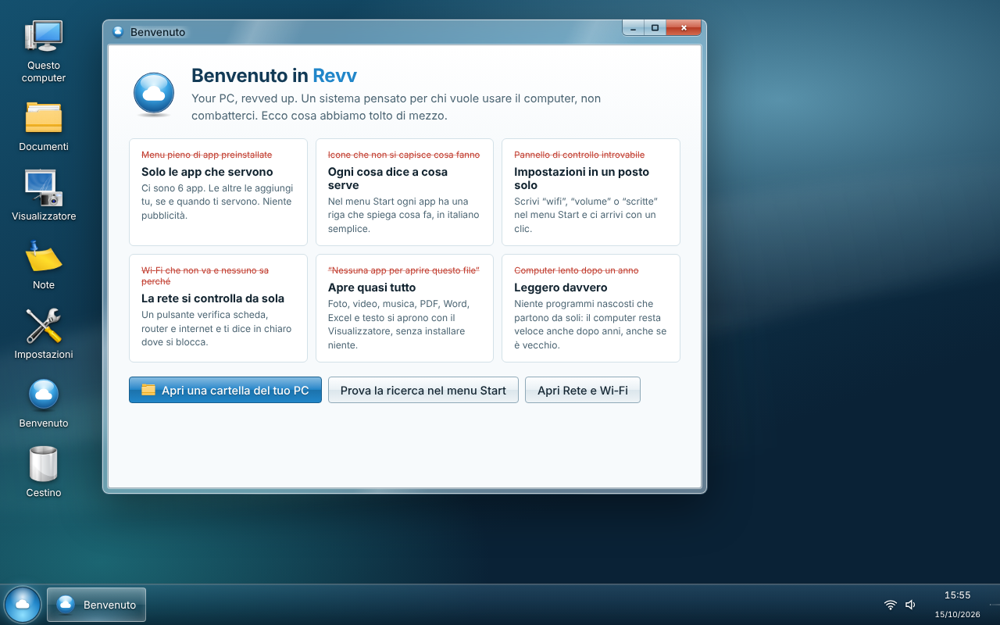
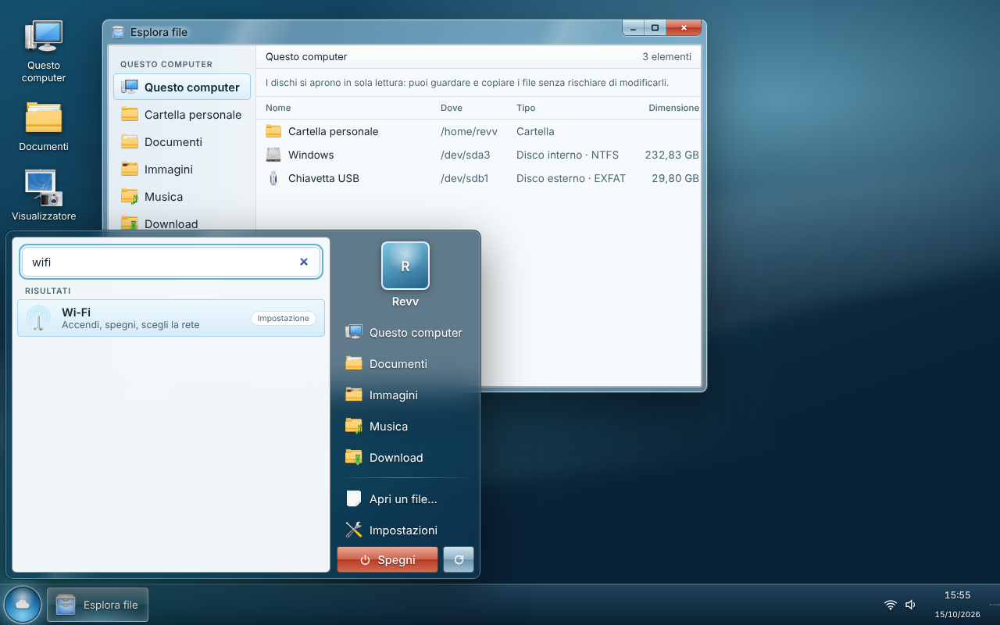
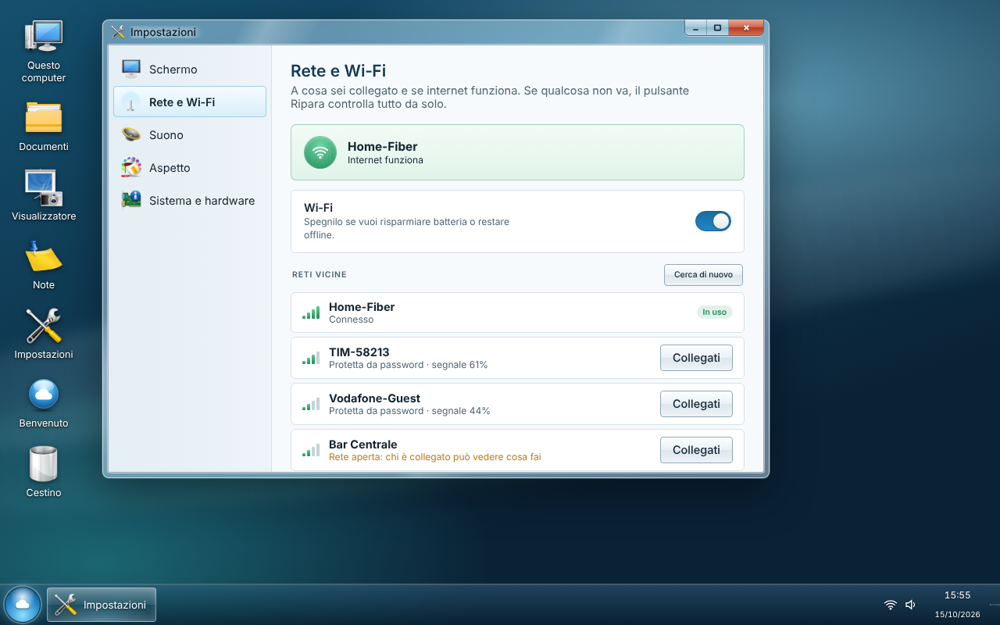
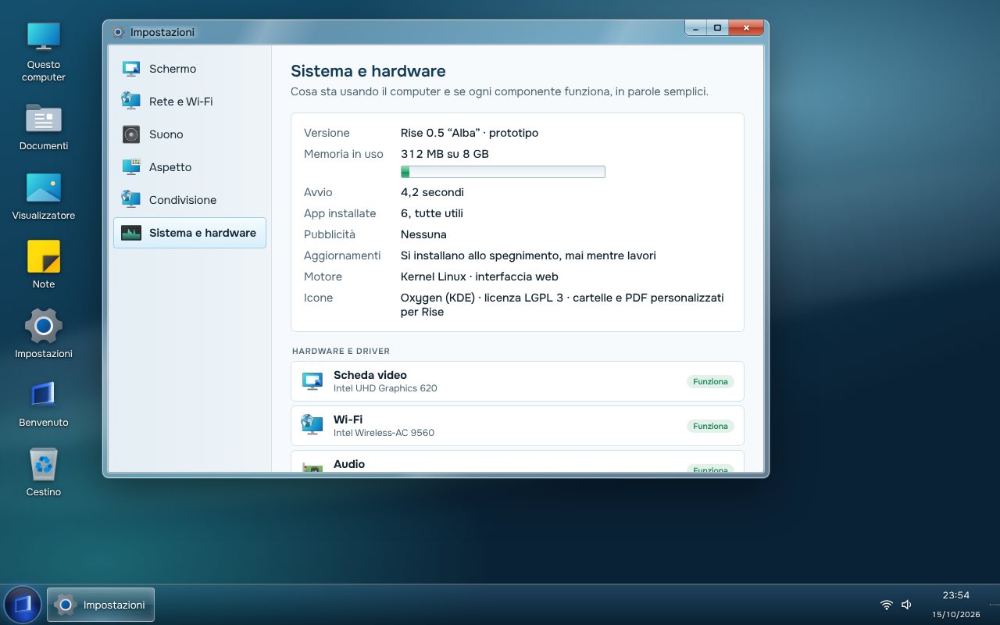

<p align="center">
  
</p>

<p align="center">
  <b>Bring your PC back to life.</b><br>
  <a href="https://www.iuppiter.ch">www.iuppiter.ch</a>
</p>

<p align="center">
  A lightweight, free Linux operating system with a classic desktop you already know how to use.<br>
  Instant local search, settings in plain words, no ads, no bloat.<br>
  Built to make old PCs and laptops fast again.
</p>

<p align="center">
  
  
  
  
</p>

<p align="center">
  
</p>

---

## Why Rise

Millions of computers end up in a drawer because the operating system got too heavy for them, not because the hardware died. Rise is the opposite of that.

| The usual problem | What Rise does |
| --- | --- |
| Start menu full of preinstalled apps nobody asked for | Only the apps you need. Each one says what it is for, in one line |
| Settings scattered across two control panels | One Settings window. Type "wifi" or "volume" in Start and you are there |
| Wi‑Fi stops working and nobody can tell why | **Check and repair** tests the network card, the router, internet and DNS step by step, and says where it breaks |
| "No app can open this file" | The built-in Viewer opens photos, video, music, PDF, Word, Excel, text and code |
| The PC gets slower every year | No hidden background services, no telemetry, no ads. Updates install at shutdown, never while you work |
| A new OS version needs a new PC | Runs on 64-bit PCs from 2010 on, with 4 GB of RAM |

## Screenshots

<table>
  <tr>
    <td></td>
    <td></td>
  </tr>
  <tr>
    <td align="center"><sub>One search box for apps, settings and files</sub></td>
    <td align="center"><sub>Wi‑Fi in plain words, open networks flagged</sub></td>
  </tr>
  <tr>
    <td colspan="2"></td>
  </tr>
  <tr>
    <td colspan="2" align="center"><sub>Every component and its driver, with a clear "Works" or "Driver missing"</sub></td>
  </tr>
</table>

## Try it

1. Download the latest ISO from **[Releases](../../releases/latest)**.
2. Write it to a USB stick (8 GB or more) with [balenaEtcher](https://etcher.balena.io/) or [Rufus](https://rufus.ie/) (choose *DD mode* if Rufus asks).
3. Restart the PC, open the boot menu (usually **F12**, **F11**, **F9** or **Esc**) and choose the USB stick.
4. Pick **Avvia Rise**. The desktop starts on its own, and nothing is written to your disk.

If the screen stays black, restart and pick the *grafica di sicurezza* entry. If the PC uses **Secure Boot**, turn it off in the BIOS for now: signed boot is on the roadmap.

**Minimum:** 64-bit processor (2010 or newer), 4 GB RAM. Works on both UEFI and legacy BIOS.

## What works today (0.4 preview)

- Real windows for every app, managed by labwc: move, resize, snap to half screen (Win+arrows or drag to the edge), Alt+Tab
- Taskbar with every open window, programs included; Start menu (Windows key) with one search for apps, settings and files
- Office suite: WordCraft, GridCraft and DeckCraft open and save Word, Excel and PowerPoint files
- Web browser and video player
- **Rise Drop**: send and receive files with nearby phones and PCs, no internet needed, LocalSend compatible
- Shared folders: open the folders of other PCs and NAS drives, share your own with one click
- File management: new folder, rename, copy, cut, paste, recycle bin with restore
- Animated boot screen and themed boot menu
- Compressed memory (zram) for PCs with little RAM
- Real Wi‑Fi: scan, connect with password, on/off, open networks flagged as risky
- Network check and repair, step by step
- Real volume, brightness (laptops), shutdown and restart
- File explorer on your home folder and on every disk, Windows partitions included (read-only, so nothing can get damaged)
- Viewer for photos, video, music, PDF, Word (.docx), Excel (.xlsx), CSV, text and code
- System page with processor, memory, battery and each device with its driver
- Notes, Calculator
- Kernel, firmware and drivers from Ubuntu 26.04 LTS

The interface is in Italian for now. English and more languages are next.

## Roadmap

Rise is built around six pillars. ✅ = in the current preview.

### 1. Light
| Feature | Version |
| --- | --- |
| Minimal base: no hidden services, no ads, no telemetry | ✅ 0.3 |
| Boots straight to the desktop | ✅ 0.3 |
| Compressed memory (zram): 4 GB machines behave like they have more | ✅ 0.4 |
| Search index that updates at low priority, in the background | ✅ 0.4 |
| Updates installed at shutdown, never while you work | 0.5 |

### 2. Old and new hardware
| Feature | Version |
| --- | --- |
| 64-bit processors from 2010 on, 4 GB RAM | ✅ 0.3 |
| Boots on UEFI and legacy BIOS | ✅ 0.3 |
| Up-to-date kernel, firmware and drivers from Ubuntu 26.04 LTS | ✅ 0.3 |
| Hardware page: every device with its driver and a clear status | ✅ 0.3 |
| Nvidia drivers installed automatically | 0.6 |
| Secure Boot | 0.6 |

### 3. Network: Wi‑Fi, LAN and shared folders
| Feature | Version |
| --- | --- |
| Wi‑Fi: scan, password, open networks flagged | ✅ 0.3 |
| Wired network (LAN), automatic | ✅ 0.3 |
| Check and repair the connection, step by step | ✅ 0.3 |
| Open shared folders on other PCs (Windows too) and NAS drives | ✅ 0.4 |
| Share a Rise folder on the network with one click | ✅ 0.4 |
| Web browser | ✅ 0.4 |

### 4. Rise Drop: send files between devices
AirDrop-style transfer over the local network: right-click a file, choose **Send with Rise Drop**, pick a nearby device. No internet, no cables, encrypted. Rise Drop speaks the open [LocalSend](https://github.com/localsend/protocol) protocol, so it works with Windows, macOS, Android and iPhone through the free LocalSend app. Incoming files ask for confirmation and land in Downloads. ✅ **Version 0.4**

### 5. Accessibility
| Feature | Version |
| --- | --- |
| Settings in plain words, one search for everything | ✅ 0.3 |
| Larger text across the whole system | ✅ 0.3 |
| Night light | ✅ 0.3 |
| High contrast, screen magnifier, large cursor | 0.5 |
| Screen reader (Orca) and full keyboard navigation | 0.5 |
| English and more languages | 0.5 |

### 6. Everything a PC or laptop needs
| Feature | Version |
| --- | --- |
| File explorer, universal viewer, notes, calculator | ✅ 0.3 |
| Volume, brightness, shutdown and restart | ✅ 0.3 |
| Several programs at once, windows side by side, Alt+Tab | ✅ 0.4 |
| Office suite ([WordCraft](https://github.com/storytold/wordcraft), [GridCraft](https://github.com/storytold/gridcraft), [DeckCraft](https://github.com/storytold/deckcraft)), video and music player | ✅ 0.4 |
| Copy, move, recycle bin, USB sticks, file search | ✅ 0.4 |
| ZIP archives, search inside documents | 0.5 |
| Install to disk, also next to Windows | 0.5 |
| Printers, scanners, Bluetooth, multiple monitors, battery saver, task manager | 0.5 |
| Users, passwords, lock screen | 0.5 |
| App store (Flathub), Windows programs (Wine), Steam and games | 0.6 |
| Firewall and disk encryption | 0.6 |

## How it is built

Rise is a small stack on top of a solid base:

```
Rise desktop          HTML, CSS and JavaScript: windows, Start, settings, apps
rise-shell            Python + GTK 4 + WebKitGTK: desktop, taskbar, Start, app windows, bridge to the system
rise-drop             LocalSend-compatible file transfer (Python, HTTPS + UDP multicast)
labwc                 Wayland window manager: windows, snapping, Alt+Tab, shortcuts
greetd                logs in automatically and starts Rise
Ubuntu 26.04 LTS      Linux kernel, drivers, firmware, NetworkManager, PipeWire
```

`rise-shell` is the bridge between the desktop and Linux: the interface asks, the shell runs the matching tool (`nmcli`, `wpctl`, `brightnessctl`, `lsblk`, `systemctl`…) and replies.

### Build the ISO yourself

On Ubuntu 24.04 or newer, with about 15 GB free:

```sh
git clone https://github.com/finanzalive-jpg/RISE
cd rise
sudo ./build/build-iso.sh 0.3
```

The ISO lands in `out/`. Every push to `main` builds it automatically on GitHub Actions, and every tag `v*` publishes it as a Release.

### Try the desktop in a browser

Open `desktop/index.html` in any browser. Network, files and hardware are simulated there; on the real system they are live.

## Repository layout

```
desktop/        the Rise desktop (one HTML file)
system/bin/     rise-shell (desktop) and rise-session (start-up)
system/lib/     risesys (system functions), risedrop (Rise Drop), risewl (window list)
system/etc/     labwc config, auto-login, network, zram, language, keyboard
system/share/   window theme, boot splash (Plymouth), boot menu theme
art/            logo and splash sources
build/          build-iso.sh, package list, boot menu
docs/           screenshots and documentation
```

## Contributing

Rise is young and every hand helps: testing on old hardware is the most valuable thing you can do. Boot it on your oldest PC and [open an issue](../../issues/new) with the model, what worked and what did not. Code, translations and design ideas are welcome too: see [CONTRIBUTING.md](CONTRIBUTING.md).

## Website

News, downloads and contacts: **[www.iuppiter.ch](https://www.iuppiter.ch)**

## License and credits

Rise is free software under the [GNU General Public License v3.0](LICENSE). It stands on the work of many projects, listed with their licenses in [NOTICE.md](NOTICE.md). Rise is not affiliated with Microsoft; Windows is a trademark of Microsoft Corporation.
